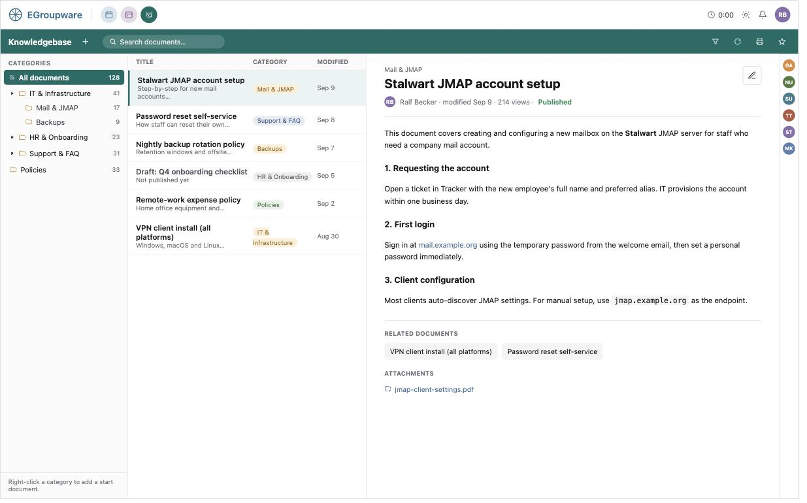
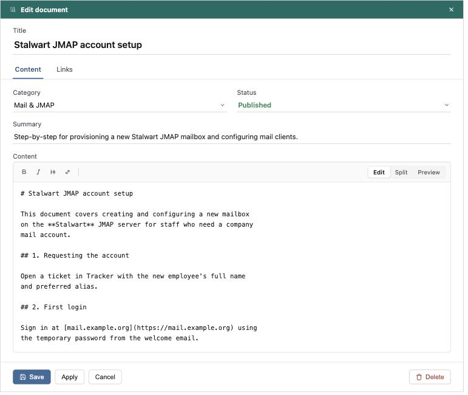

# Knowledgebase: new app design (supersedes `phpbrain` and `wiki`)

## Status: Design phase, iterating with ralf. A first CRUD skeleton (schema, `Bo`/`Ui`/
`Hooks`, popup-based edit templates) exists but is not yet installed/tested end to end -
none of the real features below (ACL tiers, history tracking, search) are built yet. This
doc is the living spec — update it as decisions change rather than tracking them only in
conversation.

Goal: a single new `knowledgebase` app that replaces both the deprecated `phpbrain`
("Knowledge Base") and `wiki` apps, covering the important/used features of both without
copying either one's legacy architecture. Built on `Api\Storage`, `Api\Storage\Tracking`
(history), `Api\Categories`, and `Api\Acl` — the same shared framework classes modern apps
(e.g. `Infolog\Storage`, see [[infolog-storage-migration]]) already use — rather than any
bespoke persistence/ACL/history mechanism.

Research behind this doc: full method/schema inventories of `phpbrain` and `wiki` (data
model, ACL, categories, features, UI, legacy-pattern call-outs), plus a framework scan of
`Api\Storage`/`Api\Storage\History`/`Api\Categories`/`Api\Acl` and the `Infolog\Storage`
template. Findings are folded into the sections below rather than kept as separate reports.

## UI mockup

Illustrative mockups (not final pixel design) matching the real EGroupware framework
chrome, to make §1 below easier to discuss before it's actually built in eTemplates.

**Main view** — category tree, document list, and a view-only reading pane (no inline
editing controls):



**Edit popup** — opened via the Edit button in the reading pane; several can be open at
once. Content tab (title/category/status/summary/body) is always first, Links after:



## 1. UI shape

Three-pane layout, modeled on the mail app:

- **Left sidebox**: a category tree (`Api\Categories`, tree-capable, `cat_appname =
  'knowledgebase'`). Selecting a node filters the center list to that category (optionally
  including subcategories, a user pref like phpbrain's `show_tree` `all`/`only_cat`).
- **Center**: an `Et2Nextmatch` list of documents in the selected category (or all, or
  search results), default sort by `kb_modified` descending. Columns: title, category,
  owner, modified date, views, status (draft/published) badge. Actions:
  view/edit/publish/delete/related, matching phpbrain's `maintain_articles` action set but
  as the primary view, not an admin-only screen.
- **Right pane**: **view only, minimal chrome** (ralf) — renders the selected document
  (Markdown→HTML or raw HTML depending on `kb_content_type`), with related-documents/
  attachments/history below it (comments/ratings deferred, see §8). No inline editing
  controls here at all; the pane's only job is reading. If a **category node** (not a
  specific document) is selected and that category has a start-document configured, show
  that document by default instead of a blank state.
- **Edit**: **a separate popup, not inline** (ralf, revised from an earlier inline-in-pane
  plan) — opening "edit" (or "add") opens a tabbed popup dialog, the same shape the app's
  CRUD skeleton already uses (`knowledgebase.edit`, `Et2Etemplate`-style popup with an
  `<et2-tabbox>`). This is deliberate, not just reusing what's already there: a popup means
  several documents can be edited at once (several popups open simultaneously), which a
  single inline pane can't do. **The first tab is always the document-editing tab itself**
  (title/category/status/content) — other aspects (links, attachments, history, ...) are
  later tabs, never ahead of it. Body widget swaps between the markdown editor and the HTML
  editor based on `kb_content_type` (see §6).

No app currently renders a category tree in its sidebox, but this isn't new widget work:
`Et2Tree`/`Et2TreeDropdown` (`api/js/etemplate/Et2Tree/`) is already a generic tree widget
with no built-in categories awareness — the relationship is the same as `Et2Select` to
`Et2SelectCategory` (`api/js/etemplate/Et2Select/Select/Et2SelectCategory.ts`): feed
`Api\Categories`' tree data into the generic tree widget, same as the select got a
categories-flavored wrapper over the generic select.

## 2. Data model

New tables, app id `knowledgebase`, column prefix `kb_`. No table reuses `phpbrain`'s
`egw_kb_*` names (kept distinct so both apps' schemas can coexist during migration).

**`egw_knowledgebase`** (documents, the `Api\Storage` main table):

| column | type | notes |
|---|---|---|
| `kb_id` | auto, PK | surrogate key (wiki had none — natural-key PK was a legacy wart) |
| `kb_title` | varchar(255) not null | |
| `cat_id` | int, meta=`category`, default 0 | FK to `egw_categories.cat_id` — named after the source column, not prefixed (matches addressbook's own `cat_id`, see §5) |
| `kb_content_type` | varchar(16), default `'markdown'` | `'markdown'` \| `'html'` — see §6 |
| `kb_content` | longtext | body, format per `kb_content_type` |
| `kb_summary` | varchar(500), nullable | optional teaser, shown in the nextmatch list and search snippets |
| `kb_status` | varchar(16), default `'published'` | `'draft'` \| `'published'` \| `'archived'` |
| `account_id` | int, meta=`account` | owner — FK to `egw_accounts.account_id`, named after the source column rather than `kb_owner` |
| `kb_created` | int, meta=`timestamp` | |
| `kb_modified` | int, meta=`timestamp` | |
| `kb_modifier` | int, meta=`account` | last editor — also an accounts FK, but keeps the `kb_` prefix rather than a bare name: `account_id` is already taken by the owner column above, and bare non-FK-mirroring names risk clashing with DB reserved words (ralf) |
| `kb_views` | int, default 0 | |

Ratings/comments columns dropped from v1 (see §8).

Plus `egw_knowledgebase_extra` (custom fields, `Api\Storage` convention: `kb_extra_id`,
`kb_extra_name`, `kb_extra_value`) — free from `Api\Storage`, no app code needed beyond
wiring the constructor, same as `Infolog\Storage`. Possibly also where unmigrated legacy
data ends up, but that's not decided yet, see §9.

**Related documents**: no separate table — a document-to-document relation is just an
`Api\Link` between two `knowledgebase` entries (`Link::link('knowledgebase', $id1,
'knowledgebase', $id2, ...)`), same mechanism as any other cross-app link, not a bespoke
self-join table like phpbrain's `egw_kb_related_art`.

**Attachments**: no bespoke table — `Api\Link`/VFS (`Link::attach_file()`,
`list_attached()`, etc.), exactly like phpbrain already does. Don't repeat wiki's
inline-image-only approach.

**External URLs** (phpbrain's `egw_kb_urls` equivalent): not a KB-specific table either —
ralf wants `Api\Link` extended to store arbitrary URLs against *any* app's entries, not just
KB's. This is its own separate, not-yet-started piece of work, intentionally scoped outside
the Knowledgebase project — see `doc/ai/projects/link-url-support.md` for the concrete
schema plan (widening `link_id2`, index restructuring). Knowledgebase just consumes it once
it exists; until then, KB's not-yet-migrated URL data needs some other holding place (§9).

**Cross-app linking**: register the standard `search_link` hook (`Api\Link` registry) so
other apps can link *to* a document, same as phpbrain. Add a `<link-to>`-style widget in the
edit template for outbound links *from* a document to other entities (infolog, tracker,
addressbook, ...) — phpbrain's UI wasn't confirmed to expose this direction; worth adding.

**No bespoke search-index table** — dropping phpbrain's `egw_kb_search` keyword-score table
entirely; see §7.

## 3. History / versioning

Use `Api\Storage\Tracking` (`Knowledgebase\Tracking extends Api\Storage\Tracking`, `$app =
'knowledgebase'`, `$id_field = 'kb_id'`, `$field2history` covering `kb_title`,
`kb_content`, `cat_id`, `kb_status`, ...), called from the `bo` layer's `save()`/
`delete()` — same pattern as `infolog_tracking`/`calendar_tracking`. This writes to the
**shared** `egw_history_log` table and is displayed for free via the shared `<historylog>`
et2 widget (`Api\Etemplate\Widget\HistoryLog`) — no bespoke history table, no bespoke
history UI, unlike both legacy apps.

This replaces:
- wiki's full-copy-per-revision storage (every edit duplicates the entire page row) — a
  content diff, stored once via `History::add(old, new)`, is what `Tracking` already gives
  us, and `History::get_rows()` already computes unified diffs for long/multiline values
  for display.
- phpbrain's historylog-as-audit-trail-only (events logged, but no actual content diff
  ever stored) — the new app gets a real diff for free instead.

For non-scalar events (attachment added/removed, related-document linked) call
`(new Api\Storage\History('knowledgebase'))->add($status_code, $kb_id, ...)`
directly. `$status_code` should be a **full descriptive string** (e.g.
`'attachment_added'`, `'attachment_removed'`, `'related_added'`, `'related_removed'`,
`'category_changed'`), not phpbrain's terse 2-letter codes (`AF`/`RF`/`AL`/`RL`/`AR`/`DR`) —
per ralf, that convention is no longer necessary for newer apps in general, not just here.

"Restore this version" (read a past `history_old_value`/`history_new_value` off a
`history_timestamp` and re-save it as current): a genuinely interesting idea, and general
enough to be worth building against the shared `<historylog>` widget for *any* app, not just
Knowledgebase — postponed to a later phase, not part of this app's v1.

Known limitation: diffing raw HTML (`kb_content_type = 'html'`) is noisier than diffing
Markdown source, since it diffs markup, not rendered text. Acceptable for v1.

## 4. ACL model

Reuses the shared `egw_acl` table (`appname = 'knowledgebase'`), **no new ACL table**. Three
tiers, in this precedence order (ralf's spec — this is the actual improvement over both
legacy apps and the thing that makes importing both of their data possible):

1. **Document-level ACL** — if any explicit grant rows exist for this specific document,
   they win outright, regardless of category or owner.
2. **Category-level ACL** — else, if any explicit grant rows exist for the document's
   category, they win over the owner default.
3. **Owner-based ACL** — else, fall back to `Acl::get_grants('knowledgebase')` keyed by the
   document's owner, exactly phpbrain's existing model (including the `CUSTOM1` = "publish"
   bit convention, kept as-is).

Implementation: distinguish tiers by `acl_location` prefix (column is ascii16, plenty of
room):
- Owner tier: `acl_location = (string) $owner_account_id` — unprefixed, identical to
  phpbrain today.
- Category tier: `acl_location = 'C' . $cat_id`.
- Document tier: `acl_location = 'D' . $kb_id`.

```php
// bo layer, sketch
$grants = Acl::get_grants('knowledgebase'); // keyed by acl_location, this user's own rights
function get_rights(array $doc) use ($grants) {
    if (Acl::get_ids_for_location($doc['kb_id'], 'D'.$doc['kb_id'], 'knowledgebase')) {
        return $grants['D'.$doc['kb_id']] ?? 0;           // tier 1 configured -> use it (0 if not granted to me)
    }
    if ($doc['cat_id'] && Acl::get_ids_for_location($doc['cat_id'], 'C'.$doc['cat_id'], 'knowledgebase')) {
        return $grants['C'.$doc['cat_id']] ?? 0;           // tier 2 configured -> use it
    }
    return $grants[$doc['account_id']] ?? 0;                // tier 3 default (document owner)
}
```

**Important subtlety**: `Acl::get_grants()` only returns rows the *current* user/their
groups can see — it can't by itself tell "no one configured tier 1" apart from "tier 1 is
configured but doesn't include me". Falling through tiers correctly requires a separate
*existence* check per tier (`Acl::get_ids_for_location()` or an equivalent raw
`COUNT(*) WHERE acl_appname='knowledgebase' AND acl_location=...`), independent of the
requesting user.

**Performance**: not a real concern at this app's expected scale (hundreds to low
thousands of documents, per ralf) — plain per-row tier-existence checks (even one extra
query per document in the worst case) are fine as-is. No prefetching/caching/combined-SQL-
filter optimization needed; revisit only if actual scale assumptions change materially.

Record owner and app admins always get full rights, short-circuiting all three tiers — same
convention as phpbrain/infolog.

**Deferred**: public/anonymous access. The model doesn't preclude it — a document- or
category-tier grant to a "public"/Default-group pseudo-account is the natural extension
point — but wiki's anonymous-session handling and abuse rate-limiting are explicitly out of
scope for now (per ralf: "public access is not used by any users").

## 5. Categories

`Api\Categories`, `cat_appname = 'knowledgebase'`, tree-capable, same shared mechanism
phpbrain already uses. **Single category per document for v1** (`cat_id` scalar column,
named after the source table's own PK — same convention addressbook already uses for its
own `cat_id` column, not `kb_cat_id`) — multi-category is explicitly not decided yet; if it
happens later, the framework convention (comma-list in the same scalar column) means it's a
handling-code change, not a schema rewrite.

**Start document per category**: use `egw_categories.cat_data` (the existing JSON
app-data column), e.g. `{"start_kb_id": 123}` — no new column/table needed. The right pane
reads this when a category node itself is selected.

## 6. Content format

Both Markdown and rich HTML are supported, per document (`kb_content_type`), because:
- New authoring defaults to **Markdown**, edited "GitHub-style": a plain textarea with
  edit/split/preview modes. This already exists — `Et2Textarea` with `markdown="true"`
  (`Et2MarkdownEditMixin`, `api/js/etemplate/Markdown/`) gives edit/split/preview toolbar
  UI (bold/italic/headings/etc., `markdown-it` rendering) for free. Read-only rendering
  uses the same rendering mixin via `Et2Description` (`markdown="true"`). **No new editor
  needs to be built** — just wire these existing widgets into the document edit/view
  templates.
- Rich HTML stays supported via the existing `Et2HtmlArea`/`Et2HtmlAreaReadonly` widgets
  (same ones phpbrain already uses) — needed because migrated content is HTML-only (see
  §8/§9): phpbrain articles are already HTML, and wiki pages get their markup converted to
  HTML once, at migration time, rather than carrying wiki's parser forward.

`kb_content_type` lets the view/edit templates pick the right widget pair per document; no
runtime format-detection needed.

## 7. Search

Correction to earlier research: `EGroupware\Rag\Embedding` is **not** a Stylite/EPL-only
extension — the `rag` app is a real, present, first-party app in this tree
(`rag/src/Embedding.php`), already the shared full-text/semantic search backend for several
apps (`Api\Storage::process_search()`, `Api\Contacts`, `infolog_bo` all call into it). Per
ralf, Knowledgebase should use it the same way every other app does — not fall back to
plain LIKE search.

How it plugs in: `Api\Storage::process_search()` already calls
`Rag\Embedding::search2criteria($app, ...)` automatically once `Rag\Embedding::available($app)`
returns non-null for that app. `available()` requires an app-specific plugin class named
either `EGroupware\Rag\Embedding\Knowledgebase` or `EGroupware\Knowledgebase\Rag`
(`Rag\Embedding::plugins()` discovers it by naming convention) — without one, RAG search is
unavailable for the app and it silently falls back to plain LIKE.

phpbrain already has such a plugin: `rag/src/Embedding/Phpbrain.php` (`extends
Embedding\Base`, declares `TABLE`, `ID`, `MODIFIED`/`CREATED`/`TITLE`/`DESCRIPTION` column
names, an optional `$additional_cols`, a `NOT_DELETED` filter, and a `processRow()` override
that strips HTML tags before indexing). The Knowledgebase app needs an equivalent
`rag/src/Embedding/Knowledgebase.php`, modeled directly on `Phpbrain.php`, pointing at the
new schema (`TABLE = 'egw_knowledgebase'`, `ID = 'kb_id'`, etc., with a `processRow()` that
strips HTML for `kb_content_type='html'` documents and passes Markdown through mostly as-is
since it's already close to plain text). `wiki` has no such plugin today — it's LIKE-only.
Once the Knowledgebase app takes over, `Phpbrain.php` should be retired/replaced accordingly.

`available()` also respects a per-user preference (`rag_search` / `default_search`:
`legacy`/`fulltext`/`hybrid`) and admin config toggles — nothing Knowledgebase needs to
build, it's already generic across apps.

Dropping phpbrain's hand-rolled `egw_kb_search` keyword-score table entirely — real RAG
fulltext/semantic search via the plugin above supersedes it outright.

## 8. Feature scope

**In v1** (concepts kept from phpbrain/wiki, reimplemented on the shared framework):
- Related-documents, via `Api\Link` self-links (see §2) — not comments/ratings, see below
- Attachments via `Api\Link`/VFS
- External URLs, via the planned `Api\Link` URL extension (see §2) — not a KB-specific table
- Cross-app linking (inbound via `search_link` hook, outbound via a link widget)
- View counter
- Draft/published/archived status with the owner/category/document ACL `CUSTOM1`
  "publish" right gating who can publish
- Real content history/diff via `Api\Storage\Tracking` (see §3)
- Real fulltext/semantic search via the `rag` app (see §7)
- Category tree with a per-category start document

**Explicitly deferred** (noted here so they aren't silently dropped, revisit later):
- **Comments** (phpbrain had per-comment moderation) — postponed to a later phase.
- **Ratings** (phpbrain's 1-5 star voting) — postponed to a later phase.
- **Multi-category per document** — start with single category (§5); decide later.
- **Public/anonymous access** — ACL model leaves room for it (§4), not built now.
- **FAQ-style Q&A intake** (phpbrain's question → answer → article pipeline) — a real,
  distinct workflow worth preserving eventually, deferred to a later phase rather than v1.
- **"Restore this version"** from history — generalized to a cross-app idea, not built now
  (see §3).

**Explicitly dropped, not carried forward at all**:
- wiki's bespoke markup engine/parser architecture (converted to HTML once at migration
  time only, see §9)
- wiki's comma-string pseudo-ACL, regex-markup-as-categories, interwiki/sisterwiki/remote
  federation tables, rate-limiting/anonymous-abuse subsystem
- phpbrain's hand-rolled keyword-search table and string-concatenated advanced-search SQL
- both apps' old-etemplate-v1/procedural-global-variable UI code

## 9. Migration

**History is not migrated from either legacy app.** The new app's history starts empty at
import time — no backfilling wiki's old revisions or phpbrain's audit trail into
`egw_history_log`. The legacy app's own data stays available (archived, not deleted) if an
old revision/audit event ever needs to be consulted.

**Preserving unmapped legacy data**: anything from either legacy app that isn't migrated
into a first-class new-schema field or relation yet (phpbrain's `topic` field and
`egw_kb_urls` until the `Api\Link` URL extension exists, `egw_kb_questions`, wiki's
`wiki_lang`/`wiki_comment`/`wiki_hostname`, any per-page ACL nuance the 3-tier model can't
represent exactly, etc.) must not be silently dropped at migration time. Exact storage
mechanism (custom fields vs. something else) is deliberately **not decided yet** — postponed
to when the migration scripts are actually written — but per ralf, whatever it is should be
**visible to the user** (e.g. shown on the document, not just internal/hidden bookkeeping),
not merely an internal audit trail.

### From `phpbrain`

Straightforward — phpbrain already uses `Api\Acl` (owner-based) and `Api\Categories`, so
most of this is a table-to-table copy with renamed columns:

| phpbrain | knowledgebase | notes |
|---|---|---|
| `egw_kb_articles` | `egw_knowledgebase` | `cat_id`→`cat_id` (unchanged name), `text`→`kb_content` (`kb_content_type='html'`), `published` bool → `kb_status` enum, `topic` → not a first-class column, preserved somehow (mechanism TBD, see above) |
| `egw_kb_comment` | *(not migrated in v1)* | comments are deferred (§8); revisit import when that phase happens |
| `egw_kb_ratings`/`votes_1..5` | *(not migrated in v1)* | ratings are deferred (§8) |
| `egw_kb_related_art` | `Api\Link` self-links (`app1=app2='knowledgebase'`) | one link per related pair, not a table copy |
| `egw_kb_urls` | `Api\Link` URL extension, once it exists (§2) | until then, preserved somehow so the data isn't lost (mechanism TBD, see above) |
| `egw_kb_questions` | *(not migrated in v1)* | FAQ intake is deferred (§8); decide at that time whether to import unanswered questions |
| `Api\Categories` (`cat_appname='phpbrain'`) | `Api\Categories` (`cat_appname='knowledgebase'`) | copy tree, same owners |
| `egw_acl` (`acl_appname='phpbrain'`, owner-keyed, incl. `CUSTOM1`) | `egw_acl` (`acl_appname='knowledgebase'`, owner tier) | copy as-is — same semantics, tier-3 only, no tier-1/2 rows needed |
| `egw_history_log` (`history_appname='phpbrain'`) | *(not migrated)* | see above |

### From `wiki`

More involved — wiki has no real ACL/category/history equivalents, so this is a genuine
transformation, not a copy:

| wiki | knowledgebase | notes |
|---|---|---|
| `egw_wiki_pages` (current/live revision only, `wiki_supercede` marks it) | `egw_knowledgebase` | `wiki_title`→`kb_title`; `wiki_body` → `kb_content` with **WikiTikkiTavi markup converted to HTML** using wiki's own parser (`wiki/parse/*.php`) invoked one-off as a migration-script library call — reusing the parser for this one-shot conversion is fine even though we don't want its architecture going forward; pages already stored as raw HTML (`is_html`) copy straight across; `kb_content_type='html'` either way; `wiki_lang`/`wiki_comment`/`wiki_hostname` not first-class columns, preserved somehow (mechanism TBD, see above) |
| `egw_wiki_pages` (older revisions, `wiki_time != wiki_supercede`) | *(not migrated)* | history migration isn't planned, see above |
| `wiki_readable`/`wiki_writable` (comma-list of pseudo-tokens/group ids) | `egw_acl` document tier (`'D'.$kb_id`) | per-page ACL is the closest existing equivalent to the new document-level tier; translate `WIKI_ACL_ALL`/`WIKI_ACL_USER` to a Default/all-users group grant (or skip, given public access is deferred, §4/§8), `WIKI_ACL_ADMIN` to the admin group, real group ids 1:1 |
| category-as-macro pages (`[[! Page1 Page2]]`) | `Api\Categories` (`cat_appname='knowledgebase'`) | one-time parse of each category page's macro block into a real category + membership, not carried forward as a live feature |
| `egw_wiki_links` (outbound link cache) | *(not migrated)* | was only used for wiki's backlink/orphan/wanted-page reports, which aren't in v1 scope |
| `wiki_username`/last-editor | `account_id`/`kb_modifier` | wiki has no true "owner" concept beyond last editor — decide at migration time whether the importing admin becomes owner instead |
| `egw_wiki_interwiki`/`sisterwiki`/`remote_pages`/`egw_wiki_rate` | *(dropped entirely)* | dead federation features / anonymous-abuse throttling, not relevant |

## 10. Open questions / decisions log

- 2026-09-08: content format — both Markdown and HTML supported per-document; existing
  `Et2MarkdownEditMixin`/`Et2HtmlArea` widgets reused, no new editor built. Migration
  produces HTML only (ralf).
- 2026-09-08: single category per document for v1; multi-category not decided (ralf).
- 2026-09-08: three-tier ACL (document > category > owner), specifically to make both
  legacy apps' data importable (ralf) — see §4.
- 2026-09-08: public/anonymous access deferred, not currently used by anyone (ralf).
- 2026-09-08: FAQ-style Q&A intake deferred to a later phase (ralf).
- 2026-09-09: comments and ratings postponed to a later phase, not v1 (ralf) — see §8.
- 2026-09-09: FK columns to shared tables are named after the source column (`cat_id`,
  `account_id`), not prefixed with `kb_` (ralf) — see §2. Resolved the ACL sketch/schema
  accordingly. Non-FK-mirroring columns (e.g. last-editor) keep the `kb_` prefix regardless
  — bare names risk clashing with DB reserved words (ralf) — so last-editor is `kb_modifier`,
  not bare `modifier`. No contradiction: the rule is specifically about columns that mirror
  another table's own PK name, not FK-ness in general.
- 2026-09-09: history status codes use full descriptive strings, not phpbrain's 2-letter
  codes — a direction for newer apps generally, not just this one (ralf) — see §3.
- 2026-09-09: ACL tier resolution doesn't need query-efficiency work at this app's expected
  scale (hundreds to low thousands of documents) (ralf) — see §4, simplified accordingly.
- 2026-09-09: search must use the `rag` app the same way other apps do, not fall back to
  plain LIKE (ralf) — corrected earlier research that wrongly said `Rag\Embedding` doesn't
  exist in this tree; see §7 for the concrete plugin-class requirement, modeled on the
  existing `rag/src/Embedding/Phpbrain.php`.
- 2026-09-09: related-documents use `Api\Link` self-links, not a bespoke table (ralf) —
  see §2/§9.
- 2026-09-09: `Api\Link` should be extended to store arbitrary URLs against *any* app's
  entries, not just Knowledgebase's, and should be done first, as its own separate piece of
  work outside this project (ralf) — split out to `doc/ai/projects/link-url-support.md`,
  with a concrete schema plan: widen `link_id2` to `varchar(1024)`, prefix-index it to 64
  chars via the schema DSL's `'colname(64)'` syntax (confirmed supported in
  `api/src/Db/Schema.php`), and split `link_lastmod` out of the composite indexes into its
  own standalone index.
- 2026-09-09: history migration from either legacy app is not planned — new app starts with
  empty history (ralf) — see §9.
- 2026-09-09: sidebox category-tree resolved — not used anywhere yet, but it's just the
  existing generic `Et2Tree` widget fed `Api\Categories` data, not new widget work (ralf) —
  see §1.
- 2026-09-09: anything not-yet-migrated from either legacy app must be preserved somehow
  rather than dropped, so it can be picked up and restructured properly in a later phase —
  but the exact mechanism (custom fields or otherwise) is deliberately postponed to
  migration-script time, not decided now; whatever it is should be visible to the user, not
  just internal bookkeeping (ralf) — see §9.
- 2026-09-09: "restore this version" generalized to a cross-app idea and explicitly
  postponed, not just an unscheduled nice-to-have (ralf) — see §3/§8.
- 2026-09-09: revised the editing UX — the document-view pane is view-only with minimal
  chrome, editing happens in a separate tabbed popup instead of inline, specifically so
  multiple documents can be edited at once (several popups open simultaneously); the
  document-editing tab is always first in that popup, other tabs (links, etc.) follow it
  (ralf) — see §1. Matches the CRUD skeleton's existing popup-based edit/add actions
  (`knowledgebase/src/Ui.php`), so no code change was needed for this, only the doc.
